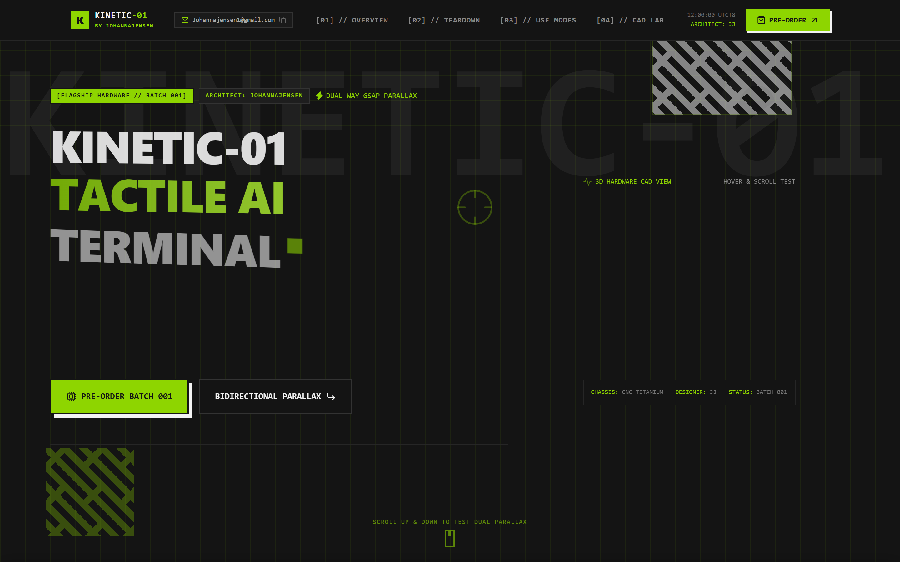
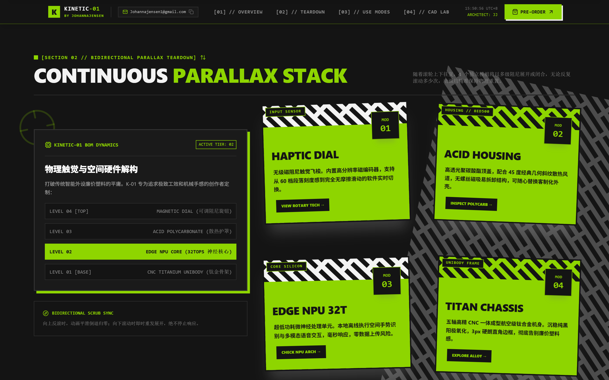
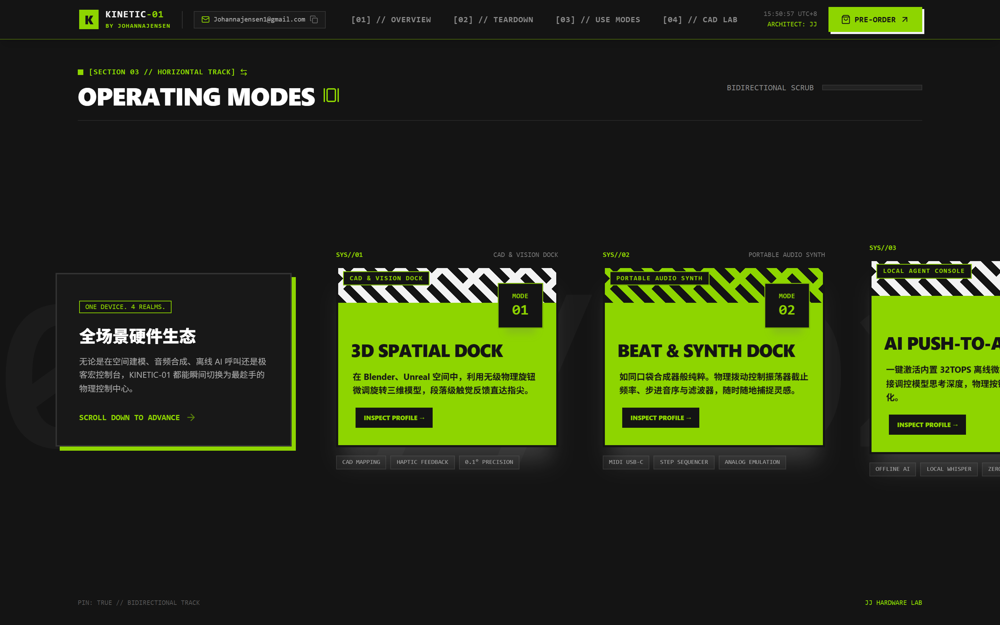
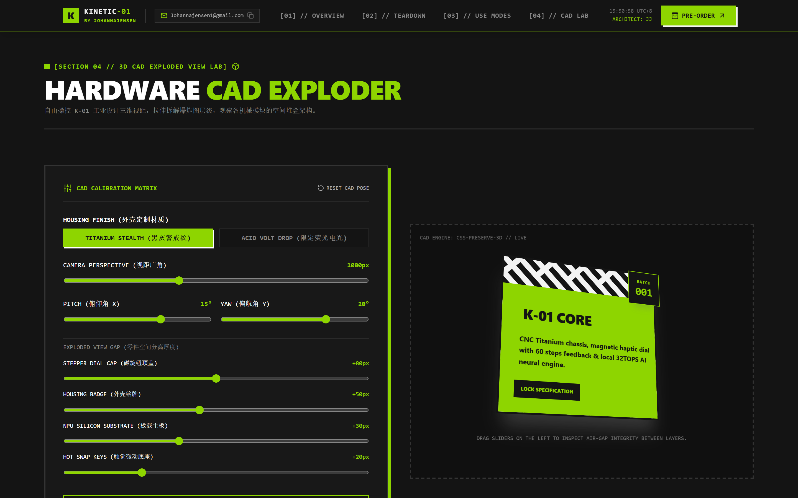
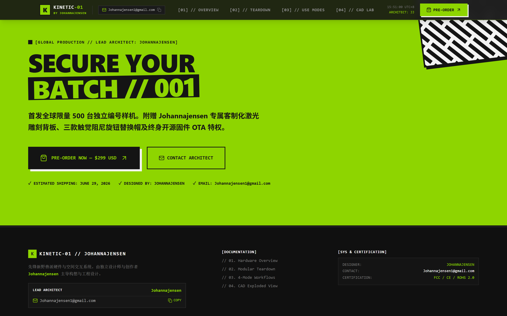

# KINETIC-01 // TACTILE AI HARDWARE TERMINAL

<div align="center">


<br/>

**⚡ 一款基于 React 19 + GSAP 3 视差引擎构建的酸性赛博新野兽派（Neo-Brutalism）极客概念硬件官方网站**

*Architected & Conceived by **Johannajensen** ([Johannajensen1@gmail.com](mailto:Johannajensen1@gmail.com))*

<br/>

[🔥 在线演示 Live Demo](https://johannajensen.github.io/neo-brutalist-landing-page/) • [设计理念](#设计细节与美学基因) • [系统截图](#系统界面截图) • [核心特性](#核心特性) • [作者与授权](#作者与致谢)

</div>

---

## 📸 系统界面截图

### 1. 首屏全貌与 3D 核心卡片 (Hero Overview & Interactive 3D Card)
> 融合真实 3D 视角（`perspective: 1000px`）、光标陀螺仪倾斜、多层 Z 轴景深悬浮与 45° 几何警戒斜纹。



---

### 2. 硬件工程解构：双向视差瀑布流 (Modular Teardown & Continuous Parallax)
> 随滚轮上下往复滚动产生多级速度差（Differential Parallax）。卡片无论反复滚动多少次，动画均可精准倒放与重新激发（`restart reverse restart reverse`）。



---

### 3. 横向视差滑轨生态 (Horizontal Track & 4-Mode Matrix)
> 借助 GSAP `ScrollTrigger` 的 `pin: true` 锁定视窗，将垂直滚轮阻尼转换为无缝横向滑轨，并配合背景反向速度文字视差。



---

### 4. 3D CAD 零件爆炸图沙盒 (CAD Exploded View Lab)
> 可视化实时调节：透视广角视距（400~2000px）、俯仰角/偏航角、零件间距（Z-Stack Exploder）以及外壳定制材质切换，支持一键导出配置参数。



---

### 5. 全球首发预售与作者联系通道 (Pre-Order & Architect Connect)
> 大面积高反差电光绿（`#8ED500`）视觉冲击，集成作者 Johannajensen 专属工坊认证与一键邮件直达。



---

## 🧬 设计细节与美学基因

本项目深入解构了现代先锋硬件工业设计（如 *Teenage Engineering*、*Nothing Phone*、*CMF* 与 *Cyberpunk HUD*）的核心视觉规范：

| 维度 | 设计细节 | 实现方式 |
| :--- | :--- | :--- |
| **色彩基因** | 高对比撞色美学 | 主色高饱和酸性电光绿 `#8ED500` + 沥青极深炭黑 `#141414` + 工业冷白 `#F3F3F3` |
| **几何构型** | 零圆角野兽派纯硬折线 | 3px 实线硬朗边框（`border: 3px solid #141414`），拒绝柔化圆角 |
| **警示斜纹** | 45° 工业蜂窝齿轮斜切纹理 | `linear-gradient` 与 `repeating-linear-gradient` 复合叠加，Hover 及滚动时产生位移流动感 |
| **3D 景深分层** | 真实的 Z 轴立体投影堆叠 | 建立 `perspective: 1000px` 视距与 `preserve-3d`，正文拉升 +30px、标题拉升 +50px、右上角日期标牌拉升至 +80px 悬空层 |
| **纯净性能** | 零外部 CDN 字体依赖 | 采用原生现代系统级字体栈（`-apple-system / Segoe UI / SFMono / ui-monospace`），极致秒开无闪烁 |

---

## ✨ 核心特性

- 🎯 **原生 3D 物理交互卡片 (`Card3D.tsx`)**：支持真实光标角度计算、悬停多层 Z 轴外弹与斜向条纹位移。
- 🔄 **连续往返视差引擎**：配置双向 ScrollTrigger 擦除动效，**彻底解决页面滑上去再滑下来动画失效或无法重置的问题**。
- 📈 **滚动触发数字增长计数器 (`MetricsCounter.tsx`)**：每次滑入视口均会重置并平滑翻滚递增。
- 🕹️ **可视化 3D CAD 沙盒 (`InteractivePlayground.tsx`)**：自由拉动爆炸图开合距离，实时预览并复制工程参数。
- 🚀 **极速工程底座**：基于 Vite 8 构建，生产构建速度小于 **400ms**，包含严格的 TypeScript 类型安全保障。

---

## 🛠️ 技术栈

* **框架与语言**：[React 19](https://react.dev/) + [TypeScript 5](https://www.typescriptlang.org/)
* **构建工具**：[Vite 8](https://vite.dev/) + [@tailwindcss/vite](https://tailwindcss.com/)
* **样式方案**：[Tailwind CSS v4](https://tailwindcss.com/)
* **动效引擎**：[GSAP 3.15](https://greensock.com/gsap/) (GreenSock Animation Platform) + [ScrollTrigger](https://greensock.com/scrolltrigger/)
* **图标库**：[Lucide React](https://lucide.dev/)

---

## 🚀 快速启动

### 1. 克隆代码仓库
```bash
git clone https://github.com/your-username/kinetic-01-hardware.git
cd kinetic-01-hardware/acid-cube-studio
```

### 2. 安装依赖
```bash
npm install
```

### 3. 启动开发服务器
```bash
npm run dev
```
打开浏览器访问：`http://localhost:5173/` (或终端提示端口)

### 4. 生产打包
```bash
npm run build
```
打包产物将输出在 `dist/` 目录，可直接托管部署至 Vercel、Cloudflare Pages、Netlify 或 GitHub Pages。

---

## 📂 项目结构

```
acid-cube-studio/
├── docs/
│   └── screenshots/           # 系统各板块高分辨率预览截图
├── scripts/
│   └── capture.js             # 自动化生成截图脚本 (Puppeteer)
├── src/
│   ├── components/
│   │   ├── Card3D.tsx         # 核心 3D 悬浮视差卡片组件
│   │   ├── Navbar.tsx         # 顶部 HUD 状态栏与作者徽标
│   │   ├── Hero.tsx           # 首屏旗舰硬件展示与大字视差
│   │   ├── MarqueeTicker.tsx  # 随滚动速度加速的工业规格跑马灯
│   │   ├── FeaturesParallax.tsx # 4 层硬件拆解视差瀑布流
│   │   ├── HorizontalShowcase.tsx # 固钉横向滑轨生态展厅
│   │   ├── InteractivePlayground.tsx # 3D CAD 零件爆炸图沙盒
│   │   ├── MetricsCounter.tsx # 滚动触发平滑递增数字看板
│   │   ├── CallToAction.tsx   # 反转色预购行动号召
│   │   ├── Footer.tsx         # 工业页脚、认证号与作者联系卡片
│   │   └── CustomCursor.tsx   # 极客准星跟随器
│   ├── App.tsx                # 应用主入口与 ScrollTrigger 初始化
│   ├── index.css              # 自定义斜纹、3D 景深与系统字体类
│   └── main.tsx               # DOM 挂载入口
├── index.html                 # 纯净 HTML 模板（已剔除 Google 外部字体）
├── package.json               # 项目依赖与 Scripts
├── tsconfig.json              # TypeScript 严格配置
└── vite.config.ts             # Vite 8 + Tailwind v4 配置
```

---

## 👤 作者与致谢

* **Lead Architect & Designer**：**Johannajensen**
* **Direct Contact / Email**：[Johannajensen1@gmail.com](mailto:Johannajensen1@gmail.com)
* **Design Philosophy**：*Neo-Brutalist Spatial Engineering & Tactile Physical Interaction.*

如果你觉得这个开源设计对你有帮助，欢迎点个 ⭐️ **Star** 支持！

---

## 📄 开源许可证

本项目基于 [MIT 许可证](LICENSE) 开源，欢迎自由学习、定制与二次分发。
